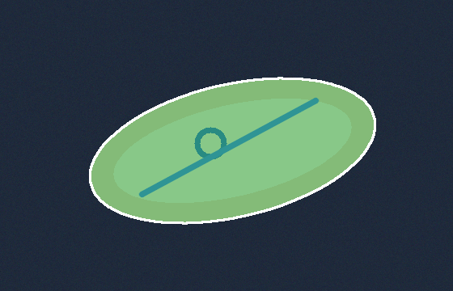

<div align="center">

# Interactive Segmentation Studio

### Box-Prompted Segmentation · Mask Measurements · Annotation Export

**Hazem Nefzi · Robotics & Computer Vision · v2.0**

Draw a box around an object, inspect the resulting mask, and export it for downstream use.

[Quick start](#quick-start) · [Workflow](#workflow) · [Demo output](#demo-output) · [Validation](#validation-and-design-notes)

</div>


*Concept illustration. See [Demo output](#demo-output) for a result generated by the project.*

## Quick start

Create and activate an isolated Python environment. For Windows instructions, see the [installation guide](docs/INSTALL.md). Run the following commands from the repository root.

### Launch the interactive studio

```bash
python -m pip install -e ".[dev,app]"
python -m streamlit run app.py
```

Upload an image and select the object with a box prompt. If you have a binary ground-truth mask for that image, upload it to compare against the generated mask.

### Run the reproducible demo

```bash
python -m pip install -e ".[dev]"
python -m segstudio.demo --output outputs
```

The demo uses synthetic inputs and writes its results to `outputs/`.

## Workflow

| Stage | What you can do |
| --- | --- |
| **1 · Prompt** | Define a rectangular region around the object you want to segment. |
| **2 · Segment** | Generate a binary foreground mask from the box prompt. SAM 2.1 integration is optional. |
| **3 · Inspect** | Review the mask and its measurements. Compare it with a reference mask if you provide one. |
| **4 · Export** | Save the annotation in a lossless format that preserves the mask data. |

## Demo output



The synthetic demo gives you a reproducible example for inspecting the pipeline. Its results describe behavior on the included examples. See the validation report for the tested conditions and limitations.

## Tests and checks

| Check | Command |
| --- | --- |
| Regression tests | `python -m pytest -q` |
| Static code checks | `python -m ruff check .` |

## Project layout

| Path | Contents |
| --- | --- |
| `app.py` | Interactive Streamlit interface |
| `segstudio/` | Segmentation package and reproducible demo |
| `tests/` | Regression tests |
| `assets/` | README banner and generated demo output |
| `docs/` | Installation, usage, design, and validation notes |

## Validation and design notes

- [Validation report](docs/VALIDATION.md) covers the executed tests, environment, and limitations.
- [Design decisions](docs/DESIGN.md) explains the algorithms, assumptions, and failure modes.
- [Detailed usage](docs/USAGE.md) documents supported inputs and workflows.
- [System card](docs/SYSTEM_CARD.md) describes intended use and evaluation boundaries.
- [Contributing guide](CONTRIBUTING.md) describes development and review expectations.

## Attribution and license

Developed with AI assistance as an engineering portfolio project. The original synthetic examples were created independently of internship and research work. The original code is available under the [MIT license](LICENSE). Optional external models and datasets retain their own licenses.
